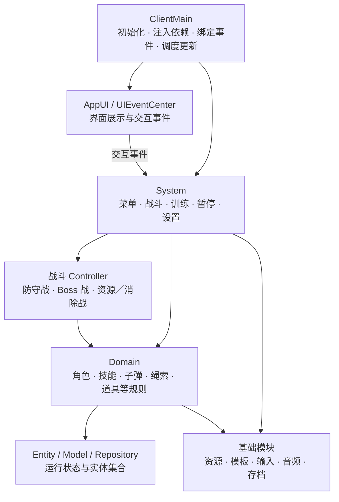

# U-force

基于 **Unity 与 C#** 开发的 2D 游戏项目，包含关卡战斗、战前卡片搭配和双角色训练对战。项目将不同玩法拆分为独立系统，并通过配置模板组织角色、技能、子弹与关卡内容。

**[▶ Bilibili 视频演示](https://www.bilibili.com/video/BV1744t6kE3U/)** · **[项目仓库](https://github.com/Lazyihui/U-force)**

## 系统与功能

| 系统 | 主要功能 |
| --- | --- |
| **关卡与进度系统** | 章节切换、关卡选择、关卡解锁、通关星级记录，以及胜负结算后的重试和返回选关。 |
| **战前选卡系统** | 按英雄、农业、工业、科技分类浏览卡片，查看详情，添加或移除出战卡片，并将所选配置传入战斗。 |
| **关卡战斗系统** | 包含防守战、Boss 战、资源／消除战三种流程，分别由独立控制器处理生成、更新与模式规则。 |
| **角色与技能系统** | 包含移动、跳跃、状态切换、技能冷却与施法逻辑；通过技能帧配置触发角色行为、子弹和场景效果。 |
| **子弹与场景交互系统** | 管理子弹移动、命中和销毁，包含激光效果、绳索抓取、场景物品和障碍物交互逻辑。 |
| **训练对战系统** | 选择两个角色进入对战场景，包含攻击／防御冷却、随机道具、生命值与倒计时显示，时间结束后按双方生命值判定胜负或平局。 |
| **UI 与图鉴系统** | 包含主菜单、选关、选卡、卡片详情、瞭望塔信息、图鉴、战斗 HUD、暂停与结算界面。 |
| **存档系统** | 通过 DTO 与二进制读写保存游戏进度，记录关卡通关状态、星级等数据。 |
| **设置与输入系统** | 支持分辨率切换、全屏、音乐／音效音量调整，以及键盘按键重绑定和恢复默认绑定。 |

### 三种关卡玩法

- **防守战**：按波次生成敌人，处理敌人进入基地后的扣血，并显示生命与波次进度。
- **Boss 战**：采用独立的敌人生成、角色行为与技能流程，包含接触伤害、无敌时间和激光更新。
- **资源／消除战**：围绕绳索抓取、场景物品、障碍物与核心交互展开，包含计时、时间道具和独立结算规则。

## 项目架构

采用 **入口组装 + 系统分工 + 领域逻辑 + 实体数据** 的组织方式。入口负责初始化、依赖注入和事件绑定，各系统通过自己的上下文获取所需模块。



### 各层职责

| 层级 | 职责 |
| --- | --- |
| **ClientMain** | 创建和初始化系统，调用 `Inject` 注入依赖，绑定跨系统事件，并在 `Update` 中统一调度。 |
| **System / Context / Events** | 管理业务流程与进入、退出、继续等生命周期；Context 保存依赖与上下文，Events 向外传递事件。 |
| **Controller** | 在战斗系统中区分不同关卡模式，组合各 Domain 的调用。 |
| **Domain** | 执行移动、状态机、施法、命中、生成和回收等具体规则；训练模式拥有自己的 Domain 实现。 |
| **Entity / Model / Repository** | Entity 与组件保存运行状态，Model 表达技能和行为数据，Repository 提供实体集合的增删查与遍历。 |
| **Module / Template / Factory** | Module 提供通用能力，ScriptableObject 与 TM 提供配置，GameFactory 根据资源和模板组装实体。 |
| **AppUI / UIEventCenter** | 管理面板与 HUD，将界面操作转成事件，交由系统和入口绑定逻辑处理。 |

资源与配置通过 **Addressables 异步加载**。角色状态机负责正常、施法等状态切换，技能由技能帧和行为配置驱动，便于组合不同角色与攻击效果。

### 核心目录

```text
Assets/
├── Src_Runtime/
│   ├── ClientMain.cs           # 程序入口与系统组装
│   ├── Systems_Game/           # 关卡战斗、模式控制器和领域逻辑
│   ├── System_Train/           # 训练对战及对应领域逻辑
│   ├── Systems_Login/         # 主菜单与选关、选卡流程
│   ├── Systems_Pause/         # 暂停流程
│   ├── Systems_Setting/       # 设置与按键绑定
│   ├── AppUI/                 # 面板、HUD 和 UI 事件
│   ├── Entity_Primary/        # 主要实体与配置模板
│   ├── Entity_Model/          # 技能、卡片与行为模型
│   ├── Repository/            # 实体集合管理
│   ├── Modules_*/             # 资源、模板、输入、音频与存档
│   └── GameFactory.cs         # 实体组装
├── Src_Editor/                # 编辑器入口
├── Res_Editor/                # 关卡与生成点编辑辅助
└── Res_Runtime/               # 运行场景与资源
```

## 技术与依赖

- **Unity 2022.3.34f1 / C#**：游戏开发环境。
- **Input System 1.7.0**：输入动作与键盘重绑定。
- **Addressables 1.21.21**：实体、UI 和模板资源加载。
- **UGUI / TextMeshPro**：界面与文本。
- **Tri Inspector**：配置字段的 Inspector 展示与条件编辑。
- **GameFunctions**：包括存档 DTO 使用的二进制编码接口。
- **URP 14.0.11**：项目依赖配置中的渲染管线包。

## 打开项目

1. 克隆仓库：`git clone https://github.com/Lazyihui/U-force.git`。
2. 使用 Unity Hub，以 **Unity 2022.3.34f1** 打开项目，等待依赖解析。
3. 打开 `Assets/Res_Runtime/Game_Scene.unity`，进入 Play 模式。

Tri Inspector 与 GameFunctions 在包配置中使用 Git SSH 地址，首次导入需要可用的 Git 与 GitHub SSH 访问配置，也可在本地将包地址调整为对应的 HTTPS 地址。

> 功能与架构说明根据仓库源码整理，未进行本机运行验证。部分接口仍在完善，例如手柄重绑定入口目前只有日志，音频播放调用也有注释保留。

